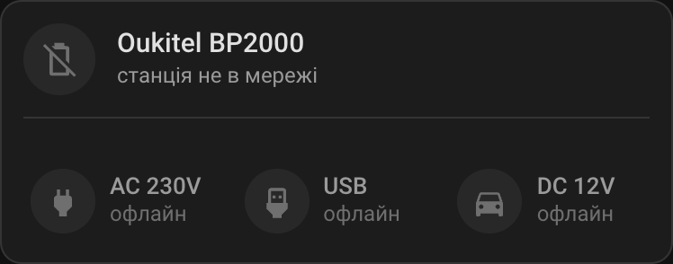

# Oukitel Station Card

One card for one Oukitel power station: the battery at the top, the three outputs
in a row under it.



## Why one card

A station dashboard usually holds a battery tile and a row of output buttons.
They are two pieces of one thing. This card draws them as one unit, so the
battery, its runtime and the three outputs share one border.

While the station is away, the card is locked. Every output is a real disabled
button, and the card sends no service call. That rule lives in JavaScript, not in
CSS, so the browser and the mobile app behave the same.

Turning AC 230V off while the house runs from the station cuts the house. An
output with `confirm: true` asks first, inside the card, when the output is on
and the grid relay is not on.

## Install

### HACS

1. Open HACS, then Frontend.
2. Open the three dots, then Custom repositories.
3. Add `https://github.com/e-potashkin/ha-oukitel-station-card` with category
   `Lovelace`.
4. Install the card and reload the page.

### Manual

1. Copy `oukitel-station-card.js` to `/config/www/`.
2. Add the resource `/local/oukitel-station-card.js` as a JavaScript module.
3. Put a version in the URL, for example `?v=1`, and change it after every
   update. Home Assistant caches `/local` for 31 days.

## Configuration

```yaml
type: custom:oukitel-station-card
name: Oukitel BP2000
battery: sensor.oukitel_battery
online: binary_sensor.oukitel_device_online
runtime: sensor.oukitel_runtime_estimate
input_power: sensor.oukitel_total_input_power
output_power: sensor.oukitel_total_output_power
grid: binary_sensor.grid_present_relay
outputs:
  - entity: switch.oukitel_ac_output
    name: AC 230V
    icon: mdi:power-plug
    confirm: true
  - entity: switch.oukitel_usb_output
    name: USB
    icon: mdi:usb-port
  - entity: switch.oukitel_dc_12v_output
    name: DC 12V
    icon: mdi:car
```

## Options

| Option | Required | Meaning |
| --- | --- | --- |
| `battery` | yes | The battery percentage sensor. |
| `outputs` | yes | One to three output switches. |
| `outputs[].entity` | yes | The switch entity. |
| `outputs[].name` | no | The label. Default `Output N`. |
| `outputs[].icon` | no | The icon. Default `mdi:power-socket`. |
| `outputs[].confirm` | no | Ask before turning this output off. |
| `name` | no | The station name. Default `Oukitel`. |
| `online` | no | When this entity is not `on`, the card is away and locked. |
| `runtime` | no | Estimated hours left. Shown when the output power is above 5 W. |
| `input_power` | no | Used with `output_power` for the charging icon. |
| `output_power` | no | Used for the runtime row and the charging icon. |
| `grid` | no | With a `confirm` output: ask only when this entity is not `on`. |

Without `online`, the card treats the station as present. Without `grid`, a
`confirm` output asks before every turn-off.

## Behaviour

- The icon follows the level and the direction: `battery-30` … `battery-100`,
  `battery-charging-*` when the station takes more power than it gives.
- The percentage takes a colour: red under 30 %, amber under 60 %, green above.
- The bar is drawn only while the station is present; an away station answers
  zero to everything, and a zero is not an empty battery.
- An away card shows `station offline` (English) or `станція не в мережі`
  (Ukrainian). The language follows the profile.
- Tapping the battery row opens its more-info dialog.

## License

MIT
